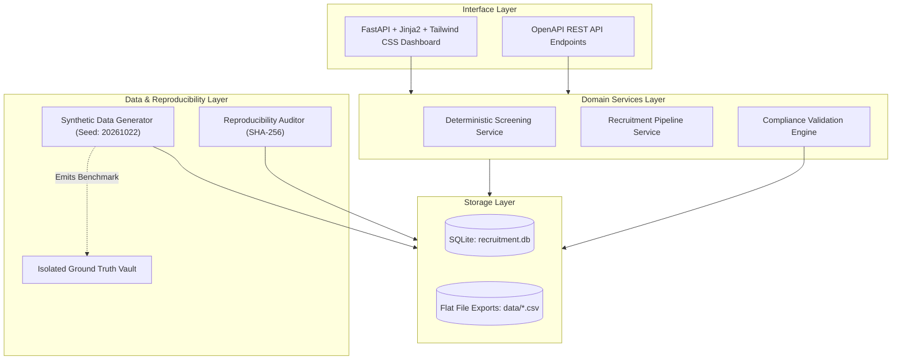

# YottaFlex AI - Autonomous Recruitment & Compliance Engine
> **Candidate Project Submission for Role: AI Forward Deployed Engineer**  
> **Challenge Window:** 72 Hours &bull; **Deterministic Seed:** `20261022` &bull; **Status:** Production-Ready & Tested

[](https://www.python.org/)
[](https://fastapi.tiangolo.com)
[](https://www.sqlalchemy.org/)
[](https://pydantic.dev/)
[](https://docs.pytest.org/)
[](#13-reproducibility-methodology)
[](LICENSE)

---

## 1. Project Title
**YottaFlex AI Recruitment Engine:** An autonomous, deterministic, compliance-first recruitment pipeline and data integrity engine engineered for enterprise AI Forward Deployed Engineering teams.

---

## 2. Problem Statement
Enterprise recruitment workflows face critical bottlenecks in transparency, data integrity, regulatory compliance, and auditability. Traditional applicant tracking systems frequently:
- Lack mathematical determinism and reproducibility.
- Overwrite state history silently, discarding vital decision audit trails.
- Mix sensitive candidate demographics into technical evaluation scoring.
- Allow scheduling and offer anomalies (e.g., unavailable interviewers, duplicate submissions, salary band breaches, missing scorecards) to slip through undetected.

**The Mission:** Build a fully demonstrable, deterministic recruitment workflow system that manages job requisitions, candidate skills, job-related screening, interview scheduling, scorecard feedback, and formal offers while surfacing intentional operational anomalies and enforcing complete relational and business rule integrity.

---

## 3. Solution Overview
The application is a full-stack, local-first enterprise solution:
- **12 Relational Entities** backed by SQLite with full foreign key constraints and bridge tables for many-to-many associations.
- **Deterministic Synthetic Data Generator (Seed: `20261022`)** producing realistic distributions of 100 requisitions, 2,000 candidates, 2,982 applications, 600 interviews, and 150 offers.
- **Job-Related Candidate Screening Service** scoring candidates purely on technical skills, experience, and domain alignment without demographic attributes.
- **Validation Compliance Engine** evaluating 43+ data integrity checks and identifying 5 injected edge-case anomalies.
- **Architecturally Isolated Ground Truth Vault** (`data/ground_truth.json` & `data/ground_truth.csv`) with zero feature leakage into production data.
- **Web UI & REST API** built with FastAPI, Jinja2, and Tailwind CSS offering 360-degree candidate dossiers, interactive dashboards, and live verification tools.
- **Comprehensive Pytest Suite** containing 50 unit and integration tests covering all critical invariants.

---

## 4. Architecture
The system uses a clean layered architecture with clear separation of concerns:



---

## 5. Tech Stack
- **Backend Framework:** FastAPI `0.110+` (High-performance ASGI framework)
- **Database ORM:** SQLAlchemy `2.0+` with SQLite foreign key pragma enforcement
- **Data Serialization & Validation:** Pydantic `v2.6+`
- **Synthetic Data Generation:** Faker `24.0+` + seeded Python random
- **Data Processing & Export:** Pandas `2.2+`
- **Testing Suite:** Pytest `8.0+`
- **Frontend / UI:** Jinja2 templates styled with Tailwind CSS (CDN) and FontAwesome
- **CLI Formatting:** Tabulate `0.9+`

---

## 6. Entity & Data Model
The schema comprises 12 primary tables with relational foreign keys:

1. **`departments`**: Master business units (PK: `department_id`, e.g., `DEP-001`).
2. **`job_requisitions`**: Approved hiring mandates with salary bands (PK: `requisition_id`, e.g., `REQ-2026-000001`).
3. **`candidates`**: Applicant master profiles (PK: `candidate_id`, e.g., `CAND-000001`).
4. **`resume_artifacts`**: Resume text summaries, domains, and cryptographic SHA-256 digests (PK: `artifact_id`, e.g., `ART-000001`).
5. **`skills`**: Standardized technical skill taxonomy (PK: `skill_id`, e.g., `SKL-001`).
6. **`candidate_skills`**: Bridge table for candidate competencies and experience (Composite PK: `candidate_id`, `skill_id`).
7. **`screening_rules`**: Requisition technical requirements, weights, and mandatory flags (PK: `rule_id`, e.g., `RULE-000001`).
8. **`applications`**: Links candidate to requisition with screening score and status (PK: `application_id`, e.g., `APP-REQ-CAND`).
9. **`interviewers`**: Evaluator profiles with available day schedules (PK: `interviewer_id`, e.g., `EMP-0001`).
10. **`interviews`**: Scheduled evaluation rounds and timestamps (PK: `interview_id`, e.g., `INT-2026-000001`).
11. **`feedback`**: Structured ratings (1-5) and hiring recommendations (PK: `feedback_id`, e.g., `FB-INT-EMP`).
12. **`offers`**: Formal compensation contracts with executive approval status (PK: `offer_id`, e.g., `OFF-2026-000001`).

*For full column definitions, constraints, and validation rules, see [docs/data_dictionary.md](docs/data_dictionary.md).*

---

## 7. Business Workflow
The recruitment pipeline moves through deterministic lifecycle milestones:
1. **Master Data & Mandate Creation:** Departments, skills catalog, and approved requisitions are initialized.
2. **Candidate Sourcing:** Synthetic candidates, resume metadata artifacts, and verified skill profiles are ingested.
3. **Application Ingestion & Job-Related Screening:** Candidates submit applications. Deterministic scoring evaluates technical skill match, experience, education, and domain alignment. Missing mandatory skills result in immediate disqualification.
4. **Interview Scheduling:** Candidates passing screening ($\ge 70\%$) transition to `INTERVIEWING`. Interviews are matched against interviewer day availability.
5. **Scorecard Feedback Collection:** Evaluators submit structured 1-5 ratings across Technical, Communication, and Problem Solving, with overall recommendations.
6. **Offer Extension & Approval:** Successful candidates receive formal offers with compensation validated against requisition bands.
7. **Candidate Decision:** Candidates `ACCEPT` (transitioning to `HIRED`) or `DECLINE` (transitioning to `REJECTED`).

---

## 8. Data Generation Strategy
- **Master Seed:** `20261022` utilized uniformly across `random.seed()` and `Faker.seed_instance()`.
- **Derived Values vs. Randomness:**
  - Screening scores are computed mathematically via `calculate_candidate_score()`.
  - Rejection reasons are generated based on identified skill or experience deficits.
  - Feedback recommendations (`STRONG_HIRE`, `LEAN_HIRE`, `NO_HIRE`) derive directly from average ratings.
  - Offer salaries scale within the requisition's approved `min_salary` and `max_salary`.
- **Parameterization:** Supports full baseline scale or fast test scale (`--quick`) for rapid developer testing.

---

## 9. ID Conventions
All entities utilize immutable, zero-padded, human-readable IDs:
- **Department:** `DEP-001`
- **Requisition:** `REQ-2026-000001`
- **Candidate:** `CAND-000001`
- **Resume Artifact:** `ART-000001`
- **Skill:** `SKL-001`
- **Screening Rule:** `RULE-000001`
- **Application:** `APP-REQ-2026-000001-CAND-000001`
- **Interviewer:** `EMP-0001`
- **Interview:** `INT-2026-000001`
- **Feedback:** `FB-INT-2026-000001-EMP-0001`
- **Offer:** `OFF-2026-000001`

---

## 10. Validation Rules
The `ValidationEngine` executes 43 distinct checks categorized into:
- **Primary-Key Uniqueness:** Verifies zero duplicate PKs across all 12 tables and bridge composites.
- **Foreign-Key Referential Integrity:** Verifies all child FKs reference valid, existing parent entities.
- **Enum Domain Integrity:** Validates status, role level, education, proficiency, and decision values.
- **Date Orderings:** Validates `open_date <= close_date`, `applied_date <= scheduled_at <= offer_date`, and `offer_date <= expiration_date`.
- **Arithmetic Reconciliation:** Validates that composite screening scores fall strictly within `[0.0, 100.0]`.
- **Business Rule Compliance:** Checks for duplicate applications, interviewer availability, missing feedback on advanced applications, salary band violations, and active applications on closed roles.

---

## 11. Edge Cases & Intentional Anomalies
Five intentional negative test scenarios are deterministically injected to benchmark compliance audits:

| # | Anomaly Type | Target Entity | Record ID | Issue Description |
| :- | :--- | :--- | :--- | :--- |
| **1** | `INTERVIEW_UNAVAILABLE_INTERVIEWER` | `interviews` | `INT-2026-000001` | Interview scheduled on Tuesday, but interviewer `EMP-0001` is only available on other weekdays. |
| **2** | `DUPLICATE_APPLICATION` | `applications` | `APP-...-DUP` | Candidate `CAND-000001` applied twice to requisition `REQ-2026-000001`. |
| **3** | `MISSING_FEEDBACK_STAGE_ADVANCED`| `feedback` | `FB-INT-2026-000002` | Candidate advanced to `HIRED` following an interview that has zero recorded feedback. |
| **4** | `SALARY_OUTSIDE_BAND` | `offers` | `OFF-2026-000001` | Offer salary exceeds maximum approved requisition band. |
| **5** | `CLOSED_ROLE_ACTIVE_APPLICATION` | `applications` | `APP-...-CLOSED-ACTIVE` | Requisition is `CLOSED`, but an associated application remains active in `INTERVIEWING` status. |

---

## 12. Ground-Truth Methodology
- **Decoupled Vault:** Ground truth records are stored independently in `data/ground_truth.json` and `data/ground_truth.csv`.
- **Zero Feature Leakage:** Production database models and entity CSV files contain **no** ground-truth columns (`is_anomaly`, `anomaly_id`, etc.).
- **Independent Discovery:** The validation engine evaluates data invariants directly against raw entity records without inspecting the ground-truth vault.

---

## 13. Reproducibility Methodology
Running the generator with seed `20261022` produces 100% bitwise identical files across independent runs.
- **Audit Verification:** `scripts/check_reproducibility.py` generates two independent datasets from ground zero and compares SHA-256 cryptographic digests across all 14 files.
- **Bitwise Result:** Every file matches exactly (0 byte discrepancy).

---

## 14. Installation

### Prerequisites
- Python 3.11, 3.12, or 3.13 installed.
- Git (optional, for clone).

### Setup Environment
```bash
# 1. Clone or navigate to the repository
cd yottaflex-code-challenge

# 2. Create virtual environment
python -m venv .venv

# 3. Activate virtual environment
# On Windows:
.venv\Scripts\activate
# On Linux/macOS:
source .venv/bin/activate

# 4. Install dependencies
pip install -r requirements.txt
```

---

## 15. How to Run

### Start the Application Server
```bash
uvicorn app.main:app --reload
```
Once started, open your web browser:
- **Interactive Web Dashboard:** [http://127.0.0.1:8000](http://127.0.0.1:8000)
- **Interactive OpenAPI Documentation:** [http://127.0.0.1:8000/docs](http://127.0.0.1:8000/docs)
- **ReDoc API Explorer:** [http://127.0.0.1:8000/redoc](http://127.0.0.1:8000/redoc)

---

## 16. How to Generate Data
Generate baseline data (100 reqs, 2,000 cands, 2,982 apps, 600 interviews, 150 offers):
```bash
python scripts/generate_data.py
```

### Options:
- `--seed <int>`: Customize random seed (default: `20261022`).
- `--quick`: Fast test generation (small scale for rapid testing).
- `--requisitions <int>`, `--candidates <int>`, etc.: Granular count overrides.

Seed SQLite database from existing CSV exports:
```bash
python scripts/seed_db.py
```

---

## 17. How to Run Tests
Run the entire 50-test automated test suite:
```bash
python -m pytest
```

Run specific test suites:
```bash
# Test deterministic reproducibility
python -m pytest tests/test_reproducibility.py

# Test validation engine & anomaly detection
python -m pytest tests/test_validation_engine.py

# Test REST API endpoints
python -m pytest tests/test_api_endpoints.py
```

Run CLI validation and reproducibility audit scripts:
```bash
# Run CLI Validation Report
python scripts/run_validation.py

# Run CLI Bitwise Reproducibility Checker
python scripts/check_reproducibility.py --baseline
```

---

## 18. API Documentation
All endpoints support JSON responses, query parameters, and auto-generated OpenAPI documentation.

| Method | Endpoint | Description |
| :--- | :--- | :--- |
| `GET` | `/health` | Service health status |
| `GET` | `/dashboard` | Aggregated metrics, pipeline funnel, screening pass rates |
| `GET` | `/departments` | Master departments catalog |
| `GET` | `/requisitions` | Job requisitions with department and status filters |
| `GET` | `/candidates` | Candidate profiles, skills, and resume metadata |
| `GET` | `/applications` | Filterable candidate applications with screening scores |
| `GET` | `/applications/{id}`| 360-degree application dossier with candidate, interviews, and offer |
| `GET` | `/interviews` | Scheduled interview rounds and structured feedback |
| `GET` | `/offers` | Formal employment contracts and approval statuses |
| `GET` | `/anomalies` | Ground-truth anomaly benchmark records |
| `GET` | `/validation` | Real-time integrity audit report |
| `POST` | `/validate` | Trigger live validation run on demand |
| `POST` | `/generate` | Generate fresh synthetic dataset |
| `POST` | `/reproducibility` | Verify bitwise hash reproducibility |

---

## 19. Example API Calls

### 1. Health Check
```bash
curl -X GET http://127.0.0.1:8000/health
```
**Response:**
```json
{
  "status": "healthy",
  "service": "YottaFlex AI Recruitment Engine",
  "version": "1.0.0"
}
```

### 2. Application 360° Dossier
```bash
curl -X GET http://127.0.0.1:8000/applications/APP-REQ-2026-000001-CAND-000001
```

### 3. Live Validation Audit
```bash
curl -X GET http://127.0.0.1:8000/validation
```

---

## 20. Expected Outputs

### Baseline Generation Row Counts:
- **Departments:** 6 records
- **Job Requisitions:** 100 records
- **Candidates:** 2,000 records
- **Resume Artifacts:** 2,000 records
- **Skills:** 15 records
- **Candidate Skills (Bridge):** 9,917 records
- **Screening Rules:** 400 records
- **Applications:** 2,982 records
- **Interviewers:** 50 records
- **Interviews:** 600 records
- **Feedback:** 599 records (1 intentional missing feedback anomaly)
- **Offers:** 150 records
- **Ground Truth Anomalies Injected:** 5 records

### Validation Engine Results:
- **Total Checks Run:** 43
- **Passed Checks:** 38
- **Failed Checks (Anomalies Flagged):** 5
  - `DUPLICATE_APPLICATION` flagged on record `APP-REQ-2026-000001-CAND-000001-DUP`
  - `INTERVIEW_UNAVAILABLE_INTERVIEWER` flagged on record `INT-2026-000001`
  - `MISSING_FEEDBACK_STAGE_ADVANCED` flagged on record `FB-INT-2026-000002`
  - `SALARY_OUTSIDE_BAND` flagged on record `OFF-2026-000001`
  - `CLOSED_ROLE_ACTIVE_APPLICATION` flagged on record `APP-REQ-2026-000015-CLOSED-ACTIVE`

### Reproducibility Results:
- 14 out of 14 CSV/JSON files produce 100% bitwise matching SHA-256 hashes across independent runs.

---

## 21. Project Structure
```
yottaflex-code-challenge/
├── app/
│   ├── __init__.py
│   ├── main.py                  # FastAPI application entrypoint
│   ├── config.py                # System settings and seed constants
│   ├── database.py              # SQLite connection & session management
│   ├── models.py                # 12 SQLAlchemy ORM entities
│   ├── schemas.py               # Pydantic v2 schemas
│   ├── routes/
│   │   ├── __init__.py
│   │   ├── api.py               # REST API controllers
│   │   └── ui.py                # Jinja2 HTML route controllers
│   ├── services/
│   │   ├── __init__.py
│   │   ├── screening_service.py # Deterministic job-related scoring
│   │   └── recruitment_service.py# Seeding & queries
│   ├── generators/
│   │   ├── __init__.py
│   │   └── synthetic_data_generator.py # Deterministic synthetic engine
│   ├── validators/
│   │   ├── __init__.py
│   │   └── validation_engine.py # 43+ integrity check engine
│   └── templates/               # Responsive HTML templates
│       ├── base.html
│       ├── dashboard.html
│       ├── requisitions.html
│       ├── candidates.html
│       ├── applications.html
│       ├── application_detail.html
│       ├── interviews.html
│       ├── offers.html
│       ├── anomalies.html
│       ├── validation.html
│       └── reproducibility.html
├── data/                        # Generated CSVs, ground truth, & SQLite DB
├── tests/                       # 50 Pytest automated tests
├── scripts/                     # Standalone CLI tools (generate, validate, etc.)
├── docs/                        # Architecture, Data Dictionary, AI Collaboration Log
├── requirements.txt
├── README.md
├── .gitignore
└── LICENSE
```

---

## 22. Design Decisions & Trade-Offs
1. **SQLite over PostgreSQL/MySQL:** Chosen for instant local reviewer execution with zero external container or cloud service dependencies. Foreign keys are enforced via `PRAGMA foreign_keys=ON;`.
2. **FastAPI + Server-Rendered Jinja2 + Tailwind CSS:** Provides a unified, single-process web server without requiring a separate Node.js / React build process or Streamlit session overhead.
3. **Decoupled Ground Truth:** Kept strictly outside entity feature tables to prevent data leakage in AI/ML workflows while enabling objective benchmarking.
4. **Deterministic Pseudo-Randomness:** Fixed seed `20261022` applied to both Python's native `random` and `Faker`, ensuring reproducible test assertions and bitwise SHA-256 parity.
5. **Job-Related Screening:** Candidate scoring uses skills, experience, qualifications, and resume specializations. Demographic attributes (race, gender, age) are intentionally excluded.

---

## Lawful Synthetic Data Attestation
All data generated by this repository is **100% synthetic**. No real personal data, confidential company records, or proprietary applicant information was collected, stored, or utilized in this project.
