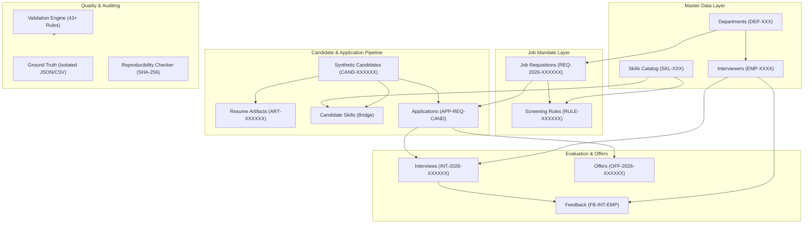
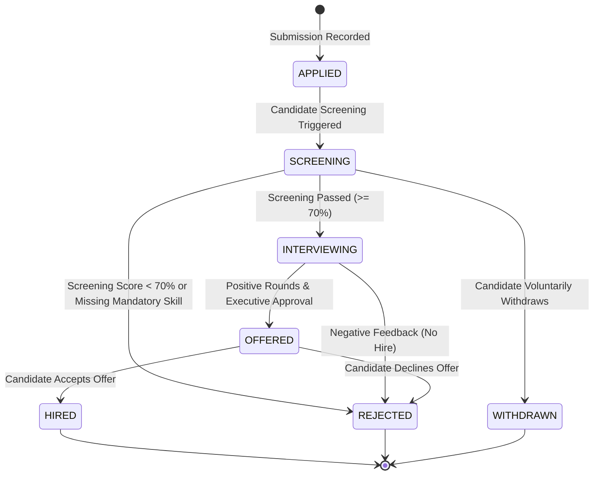
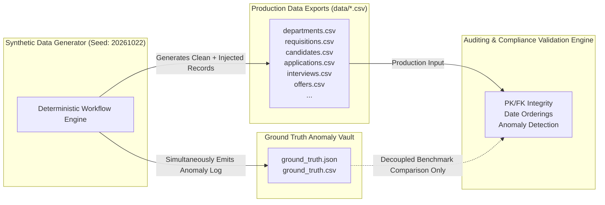

# Architecture & System Design - YottaFlex AI Recruitment Engine

## 1. High-Level System Architecture

The YottaFlex AI Recruitment Engine is an autonomous, deterministic, compliance-first hiring and evaluation framework designed for enterprise AI Forward Deployed Engineering teams.

---

## 2. Entity Relationships & Cardinalities

| Relationship | Cardinality | Bridge / Foreign Key | Description |
| :--- | :--- | :--- | :--- |
| `Department` &rarr; `JobRequisition` | 1 to Many | `requisitions.department_id` | A department sponsors multiple approved requisitions |
| `Department` &rarr; `Interviewer` | 1 to Many | `interviewers.department_id` | Engineering/talent staff belong to a department |
| `JobRequisition` &rarr; `ScreeningRule` | 1 to Many | `screening_rules.requisition_id`| Requisitions define required and optional skill criteria |
| `Skill` &rarr; `ScreeningRule` | 1 to Many | `screening_rules.skill_id` | Skills catalog linked to evaluation rules |
| `Candidate` &rarr; `ResumeArtifact` | 1 to 1 | `resume_artifacts.candidate_id` | Each candidate possesses exactly one verified resume artifact |
| `Candidate` &rarr; `Skill` | Many to Many | `candidate_skills` | Bridge table tracking skill proficiencies and years of experience |
| `Candidate` &rarr; `Application` | 1 to Many | `applications.candidate_id` | Candidates submit applications to specific requisitions |
| `JobRequisition` &rarr; `Application` | 1 to Many | `applications.requisition_id` | Applications target a single open job requisition |
| `Application` &rarr; `Interview` | 1 to Many | `interviews.application_id` | Qualified applications progress through multiple interview rounds |
| `Interviewer` &rarr; `Interview` | 1 to Many | `interviews.interviewer_id` | Interviewers are scheduled according to verified day availability |
| `Interview` &rarr; `Feedback` | 1 to 1 | `feedback.interview_id` | Each interview round requires structured scorecard feedback |
| `Interviewer` &rarr; `Feedback` | 1 to Many | `feedback.interviewer_id` | Interviewers record ratings across multiple rounds |
| `Application` &rarr; `Offer` | 1 to 1 | `offers.application_id` | Successful candidates receive formal offers with compensation bands |

---

## 3. Application Lifecycle State Machine

---

## 4. Job-Related Screening Algorithm

To guarantee legal compliance and avoid discriminatory bias, screening utilizes **strictly job-related technical factors**:

$$\text{Total Score} = 0.50 \cdot S_{\text{skills}} + 0.30 \cdot S_{\text{experience}} + 0.10 \cdot S_{\text{education}} + 0.10 \cdot S_{\text{domain}}$$

### Scoring Components:
1. **Skill Match ($S_{\text{skills}}$ - 50% Weight)**:
   - For every rule in `screening_rules`, the candidate's verified proficiency is checked against `min_proficiency`:
     - $\text{Ratio} = 1.0$ if candidate proficiency $\ge$ required proficiency.
     - $\text{Ratio} = \text{Prof}_{\text{cand}} / \text{Prof}_{\text{req}}$ otherwise.
   - **Mandatory Skill Enforcement**: If a rule has `is_mandatory = True` and the candidate either lacks the skill or possesses sub-threshold proficiency, the candidate is **automatically disqualified** regardless of numerical score.
2. **Experience Alignment ($S_{\text{experience}}$ - 30% Weight)**:
   - Compares candidate's verified years of experience to requisition minimum:
     - $\ge 1.5\times$ required: 100 points
     - $1.0\times - 1.5\times$ required: 85 - 100 points
     - $0.7\times - 1.0\times$ required: 60 - 85 points
     - $< 0.7\times$ required: $< 60$ points (Penalized)
3. **Education Foundation ($S_{\text{education}}$ - 10% Weight)**:
   - Structured ratings for vocational and academic preparation (Bootcamp: 70, BSc: 80, MSc: 90, PhD: 100).
4. **Domain Semantic Alignment ($S_{\text{domain}}$ - 10% Weight)**:
   - Matches candidate's resume specialization with role family (e.g., AI/LLM, Systems, Cloud, Data).

---

## 5. Architectural Ground Truth Separation

> **Strict Non-Leakage Guarantee:**
> Ground truth records are never fed into the generation logic or application features. Production database tables contain no `is_anomaly` or `anomaly_id` columns. The validation engine discovers anomalies purely by evaluating invariants against the production data.
